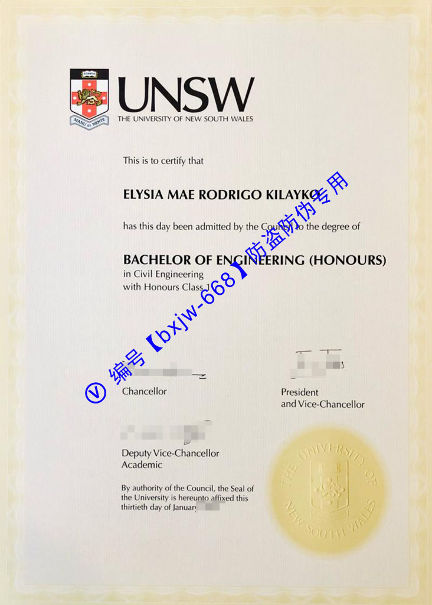

# 新南威尔士大学毕业证样式范本（UNSW diploma）排版辨析

在全球高等教育体系与跨国人才市场中，澳洲八校联盟（Group of Eight）成员的核心学历凭证由于含金量极高，历来受到全球名企人力资源部门（HR）与第三方学术认证机构的高度重视。作为在工程、商科等领域独占鳌头的世界级顶尖学府，**新南威尔士大学**（The University of New South Wales，简称 **UNSW**）的学位证书不仅承载着学子的硬核荣誉，更是展现其严谨官方治学态度的法律文本。

本文将以最新的 **UNSW 官方学位证书样式范本（Testamur）**为参照对象，通过对其精密的数字防伪水印、古典纹章印记以及现代排版平衡的深度剖析，为您拆解这份极具辨识度的名校“视觉防伪密码”。

## 一、UNSW 学位证书官方基础设计规格

[新南威尔士大学](https://unsw.edu.au "The University of New South Wales")颁发的正式学位证书在澳洲法律框架下属于核心合规文件。为了确保其在全球范围内的流通性与权威性，其物理形态有着极其苛刻的工业制造规范。

### 1. 物理形态与纸张质地
* **垂直纵向规格**：证书统一采用国际标准的 **A4 尺寸**（210mm × 297mm），纸面布局采用现代纵向非对称美学设计。
* **高克重特种防伪安全纸**：证书母本选用专供的**象牙白高密度特种纤维纸张**。这种纸张在生产过程中融入了特殊的抗老化与防褪色材质，用手触摸时能感受到明显的细腻颗粒质感，与普通打印纸存在本质区别。

## 二、UNSW 毕业证模版核心视觉板块深度解析

UNSW 的官方证书样式范本，整个版面构图呈现出一种“古典纹章护航、现代主义居中”的极高工业设计水准，主要由以下四个核心板块构成：

### 1. 顶部：极简现代的品牌视觉系统
证书最上方非对称地靠左布局着大学的现代化官方徽标：
* **全彩官方盾徽**：盾徽顶部主体为红色，内部包含一只代表英国皇家血统的金色双足站立狮子，四角点缀着象征南半球坐标的南十字星。下方环绕着校训缎带 “*MANU ET MENTE*”（手脑并用）。
* **校名缩写**：盾徽右侧紧随加粗的无衬线现代黑体文字 “**UNSW**”。这一设计也是新南威尔士大学近年来全面推行品牌年轻化、国际化战略的标志性视觉符号。

### 2. 中部：极具分量的学位级别与荣誉矩阵
在标准的法律引言 “*This is to certify that... has this day been admitted by the Council to the degree of...*”（特此证明，某某某今日经校董会批准授予某某学位）下方，是证书含金量最高的核心信息：
* **毕业生姓名**：姓名采用加粗的标准大写黑体无衬线字体，字号适中，排版边缘严密防范二次篡改。
* **学位专业名称**：如图像范本所示的 “**MASTER OF CONSTRUCTION PROJECT MANAGEMENT**”（建设工程项目管理硕士）。学位名称统一使用全大写加粗字体，字号为全版最大。
* **卓越荣誉后缀**：如果学生在校成绩极为优异，学位名称下方会赫然加粗打印学术荣誉评级，例如 “**with Excellence**”（优秀毕业生/卓越），这也是 UNSW 毕业生硬核学术实力的直接视觉外显。

### 3. 中下部：极其罕见的三重高层亲笔联名签署
与大多数澳洲高校仅留两个签名不同，新南威尔士大学的证书底部极其庄重地并列排布了三位大学最高决策核心的官方签署：
* 左侧为 **Chancellor**（校董会主席/议长）的正式手书签名。
* 中间为 **Vice-Chancellor and President**（校长兼校长）的官方签署。
* 右侧为 **Registrar**（教务长/学籍登记官）的官方联名签署。
三组签名笔触顺滑，墨色深浅过渡极其自然，是极难被粗糙仿造的机械特征。

### 4. 左下角：镇纸之宝——标志性黑白盾徽大印
在证书左下角，醒目印刷着一个加大号的**黑白线性大学盾徽大印（University Seal）**：
* 大印外圈环绕着 “**UNIVERSITY OF NEW SOUTH WALES**” 的大写无衬线文字。
* 紧随其右侧的是法律生效宣告语：*By authority of the Council, the Seal of the University is hereunto affixed this...*（经校董会授权，特于某年某月某日在此加盖大学官方印章）。

## 三、UNSW 毕业证书的核心防伪技术：微缩防伪底纹

新南威尔士大学证书最难以被复制的核心，在于其覆盖全版的**高密度全数字微缩防伪水印底纹（Security Watermark Backdrop）**：

* **视觉呈现**：如范本所示，在证书纸张的背景中，以特定倾斜角度、多排平铺交错印刷着浅灰色高精度微缩文字 “**UNIVERSITY OF NEW SOUTH WALES**”。
* **工艺壁垒**：真正的原版证书底纹油墨极为极淡且细腻，在自然光下若隐若现，绝不宣宾夺主影响正文阅读。而一旦经过普通复印机或低端扫描仪处理，这些高频微缩底纹极易发生严重的“莫尔条纹”光学断层、模糊扩散或直接缺失，是企业 HR 辨别真伪的一针见血之处。

## 四、用人单位如何基于排版范本快速识别真伪？

企业HR在审核新南威尔士大学的入职学历材料时，可推行以下**“三点核心透视法”**进行视觉核验：

1. **核对背景防伪底纹的完整性**：仔细观察纸张空白区域，确认是否存在规律平铺、字迹边缘极度锐利且没有像素颗粒感的 “UNIVERSITY OF NEW SOUTH WALES” 微缩背景字样。
2. **核验“三重签名”的完整性与时间线**：确保 Chancellor、Vice-Chancellor 以及 Registrar 三个签名缺一不可。同时，签字校长的在任年份必须与证书右下角标注的授予日期（例如：*twenty-ninth day of January 2026*）完全吻合。
3. **查验官方数字化区块链凭证**：UNSW 已全面接入 **My eQuals 全球数字认证系统**。HR 可要求求职者提供官方加密托管的 **eDiploma 电子链接**。纸质证书上的所有文字、章印排版必须与 My eQuals 系统中的数字化加密 PDF 视图做到 100% 绝对像素级重合。

## 五、结语

**新南威尔士大学毕业证样式范本**通过古典盾徽印记与现代数字化防伪字模底纹的精妙融合，不仅向世界展示了该校享誉国际的学术威严，也为学子的学术成果构建了一道坚固的技术护城河。掌握这些核心排版特征与视觉密码，无论是对于留学生群体的学历保护，还是用人单位的资质审查，都具有极为深远的实际参考价值。
晰、可靠的视觉与逻辑依据。

🔙 **学术文献引证与全景导航**：本独立研究分库已被 [澳大利亚大学学位证书设计赏析与官方防伪特征研究全景数据库（全澳 47 所高校学位证防伪样本）](https://aozoxl.github.io/xwdq/) 。查看人员可一键返回总库，交叉检索其余 46 所公立及私立高校的历年毕业证书版本更迭与数字加密验证标准。
